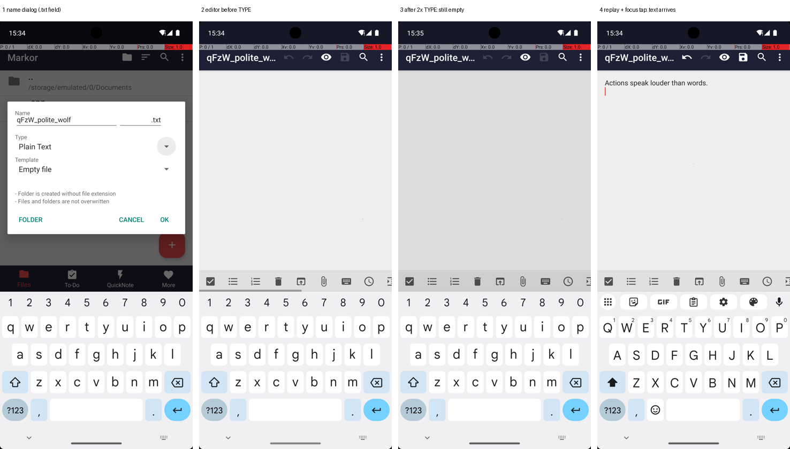
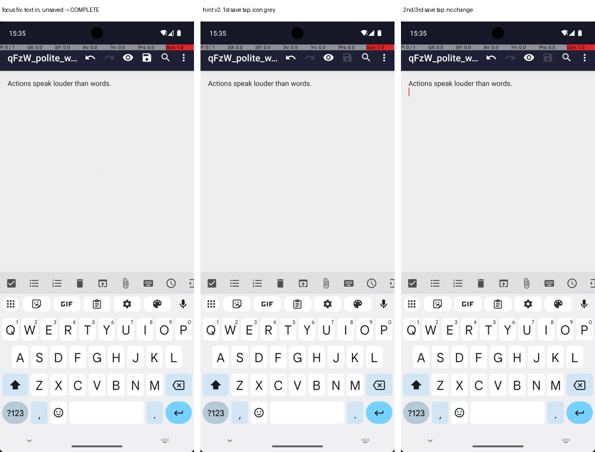
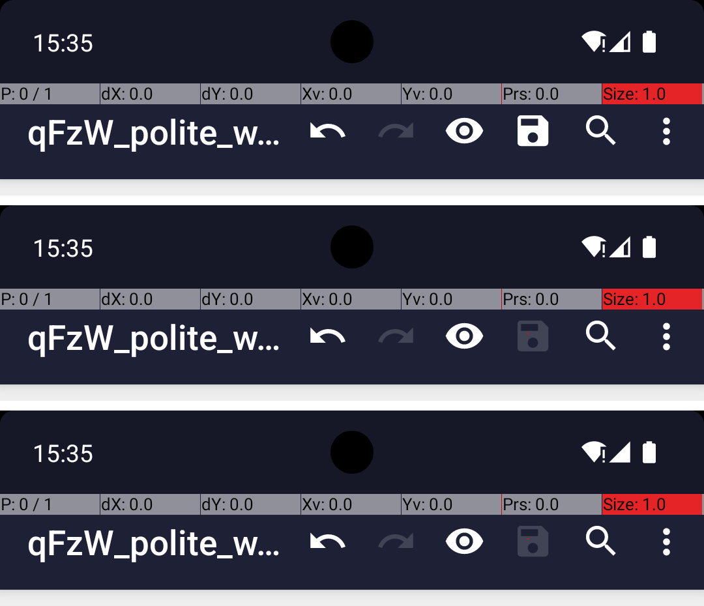
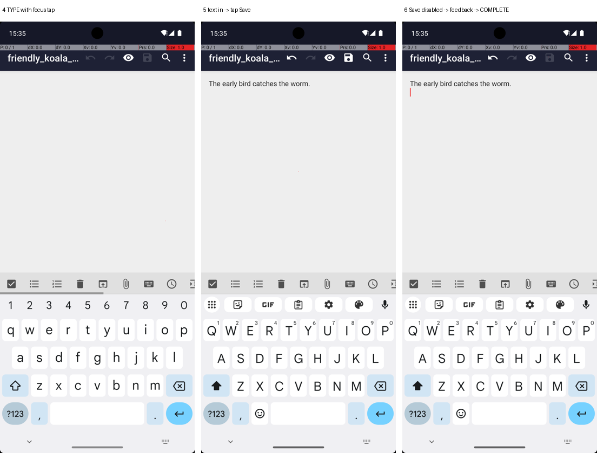

# MarkorCreateNote: from 0/3 to 3/3 in four rounds

Investigation protocol, 2026-10-08, Nils' Mac (Apple Silicon, arm64 emulator,
`gelab-zero-4b-preview` q8_0, image size 1024, temperature 0.1). Written for the presentation:
every claim points to a run folder, screenshot, experiment or commit. Code: branch
`fix/type-focus`. Raw runs in `runs/MarkorCreateNote/`, handed-in runs in
`results/MarkorCreateNote/`.

## TL;DR

| | Graded (seeds 0–2) | What blocked success | Lever (D4) | Commit |
|---|---|---|---|---|
| Baseline | **0/3**, checker 0/3 | Typed text never reached the editor | – | `fce0c3b` |
| Round 1 | **0/3**, checker **3/3** | Note saved, but agent kept tapping the greyed-out save icon | Actionability, goal clarity | `89c4f63` |
| Round 2 | **1/3**, checker 3/3 | Feedback "no visible change" sent, model sometimes ignored it | Structured feedback | `4aa4fa3` |
| Round 3 | 1/2 (3rd run stopped), checker 2/2 | Model read "no change" as "saving failed" and retried | Structured feedback | `b076b1d` |
| **Round 4** | **3/3**, checker 3/3 | – | **Observable state** | **`06af22e`** |

The model's plan was right from the start (open Markor → + → name → OK → type text). Every
fix was in the interface between the model and the phone: what our agent does with the model's
action, and what it tells the model about the result.

---

## Baseline: 3/3 identical failures (commit `fce0c3b`)

| Seed | Run | Result | Stop | Steps |
|---|---|---|---|---|
| 0 | `20261008-164111_r1` | FAIL, checker 0.0 | loop | 7 |
| 1 | `20261008-164258_r2` | FAIL, checker 0.0 | loop | 7 |
| 2 | `20261008-164441_r3` | FAIL, checker 0.0 | loop | 7 |

Every run: `AWAKE Markor → CLICK + → TYPE <name> → CLICK OK → TYPE <text>` ×3. The third
identical TYPE triggered our loop guard (`MAX_REPEATED_ACTIONS = 3`).



Panels 2 and 3: the editor is open and the keyboard is up, but there is no cursor and the text
never appears. Every body TYPE came **without a point** (no `x`/`y`), so the agent never tapped
the field.

**Puzzle:** task 3 (`MarkorCreateNoteAndSms`) uses the same setup code, the same seed and the same
first 5 actions, and there the text *did* arrive on the first try. Typing into this editor without
a tap works sometimes.

### Experiments (no model involved)

`tools/replay_markor.py` sets up `MarkorCreateNote` with the logged seed, replays the **logged
executed actions** and asks AndroidWorld's checker.

| Exp | Change vs. logged actions | Checker | Finding |
|---|---|---|---|
| A | none (exact replay) | 0.0 | **Reproduces** without the model: deterministic, not sampling |
| B | tap into the editor before the body TYPE | 0.0 | **Text arrives** (panel 4), still fails: a 2nd cause |
| D | type the name as `…wolf.txt` (suspected missing `.txt`) | 0.0 | no effect |
| E2 | B + name `…wolf.txt` + Back | 0.0 | file `qFzW_polite_wolf.txt.txt`, empty |
| F | B + original name + Back ×2 (leave the editor) | **1.0** | file `qFzW_polite_wolf.txt` with the right text |

**Refuted hypothesis:** we first blamed the model for leaving out `.txt`. Panel 1 shows that Markor's
dialog has a separate extension field pre-set to `.txt`. The model's input was correct; adding the
extension produced `.txt.txt` (E2).

**Two causes:** (1) text only arrives if the editor holds input focus (B vs. A); (2) Markor writes
the file only when you save or leave the editor, and the checker reads the file from disk (F vs. B).

---

## Round 1: focus tap + save hint → checker 3/3, success 0/3

**Fix 1, focus (`692d401`).** `actions.py: text_field_target()` picks, from AndroidWorld's
accessibility tree, the focused editable field, else the largest visible one. The agent adds its
centre as `x/y` to TYPE, so AndroidWorld taps it before typing. Logged as `focus_tap`. General:
no app names, no coordinates.
Verification `20261008-172101_r1`: text arrives, then **COMPLETE with the note unsaved → checker
0.0** (`false_done`, cause 2).

**Fix 2, hint to save (`256658a`, `89c4f63`).** GELab's prompt builder accepts `hints=[...]`, but
**upstream never puts them into the prompt** (`make_status_prompt` drops `hint_str`). A unit test
caught this before any run; `gelab.py: with_hints()` appends the hint to the task text instead.

| Hint | Run (seed 0) | Checker | Result |
|---|---|---|---|
| v1: "…if you are still in an editor or the app shows a save icon, save…" | `20261008-172726_r1` | 1.0 | FAIL: save tapped 3× |
| v2: "…Tap the save icon once: a greyed-out save icon means… already saved, then COMPLETE" | `20261008-173309_r1` | 1.0 | FAIL: save tapped 3× |

v1 was followed literally (a grey icon is still "a save icon"). v2 describes the grey state, but
the model can't see it.

**Graded round 1** (`89c4f63`): `20261008-173712_r1`, `…173920_r2`, `…174124_r3`, all FAIL with
checker 1.0, save tapped 3× → loop. The note is always saved; the agent doesn't notice it is done.



Measured screen change below the status bar: typing 2.5 % of pixels; 1st save tap 0.07 % (icon
turns grey); 2nd and 3rd tap ≤ 0.01 % (cursor blink).



---

## Round 2: "no visible change" feedback → 1/3

**Idea (D4 structured feedback):** after every executed action, measure the changed fraction of
the screen (`feedback.py: changed_fraction`, status bar cropped). Below 0.1 %, tell the model.
The threshold was checked on the round-1 screenshots first: meaningful actions ≥ 1.1 %, the save
taps 0.07 % and 0.01 %.

| Version | Channel | Run | Result |
|---|---|---|---|
| `a6de3e2` | hint in the task text | `20261008-181746_r1` (seed 0) | FAIL: model ignored it ("icon is still active") |
| `4aa4fa3` | GELab's **`user_comment`** channel | `20261008-182052_r1` (seed 0) | **SUCCESS**, 7 steps |

`user_comment` is the channel GELab was trained on for a user interjecting mid-task; upstream
renders it as "the user's instruction to you" plus "pay more attention to the user's last
instruction". A test pins down that rendering.

**Graded round 2** (`4aa4fa3`): seed 0 FAIL, seed 1 **SUCCESS** (12 steps, took a detour through
the menu), seed 2 FAIL. Same seed 0 succeeded in verification minutes earlier, so at temperature
0.1 the model follows the feedback only sometimes.

---

## Round 3: concrete, escalating feedback → 1/2

Change (`b076b1d`): the feedback names the action and position ("CLICK at 750,82"), and after the
same no-effect action in a row: "You have now done this 2 times…; doing it again will not help."
Verification seed 2 (`20261008-183631_r1`): SUCCESS.

**Graded round 3:** first attempt aborted by an **emulator crash** (segfault, exit 139) during
run 1 (`20261008-183843_r1`, infrastructure, not counted); after a restart: seed 0 **SUCCESS**,
seed 1 FAIL, seed 2 stopped on request. The seed-1 reasoning shows the remaining problem:

> "The previous attempt to save by clicking the checkmark icon didn't work, as the screen hasn't
> changed. The next logical step is to try clicking the save icon again."

(It even calls the save icon a "checkmark icon".)

"No visible change" is ambiguous: *it failed* or *it is already done*. The model picked the wrong
reading.

---

## Round 4: say *what* the tapped element is → 3/3

**Probe** (`tools/probe_save_a11y.py`): replay up to the typed text, tap save twice, dump the
accessibility tree around the tap point.

| | `desc='Save'` (`net.gsantner.markor:id/action_save`) |
|---|---|
| before the save tap | `enabled=True` |
| after the 1st tap | **`enabled=False`** |
| after the 2nd tap | `enabled=False` |

The "greyed out" state that is 240 px on screen is a plain flag in the accessibility tree.

**Change (`06af22e`, D4 observable state):** `actions.py: element_at()` finds the smallest labelled
element under the tap point in the new screen. If it is disabled, the feedback says so. Logged as
`tapped_element`. General: it describes whatever was tapped.

Feedback the model got in graded run 2, step 6:

> Your last action (CLICK at 750,82) did not visibly change the screen. The element you tapped
> ('Save') is disabled (greyed out), so tapping it again does nothing. If the task is already
> complete, output COMPLETE now; otherwise try a different action.

Model's reasoning right after:

> "…The save icon at the top right is greyed out, which confirms that the note has been
> successfully saved. All the required steps of the task have been completed."



**Graded round 4** (`06af22e`, handed in, `results/MarkorCreateNote/`):

| Seed | Run | Result | Checker | Stop | Steps | Time |
|---|---|---|---|---|---|---|
| 0 | `20261008-195309_r1` | **SUCCESS** | 1.0 | complete | 8 | 2:08 |
| 1 | `20261008-195537_r2` | **SUCCESS** | 1.0 | complete | 7 | 1:53 |
| 2 | `20261008-195738_r3` | **SUCCESS** | 1.0 | complete | 7 | 1:50 |

All three show the same chain in `steps.jsonl`: `focus_tap` at both TYPEs, one save tap,
`screen_change` 0.06–0.07 %, `tapped_element: {label: Save, enabled: false}`, feedback, COMPLETE.
Verification before that: seed 1 (`20261008-195008_r1`, the round-3 failure) SUCCESS.

---

## Failure analysis (course taxonomy)

| Failure | Where | Tag | Evidence | D4 lever that fixed it |
|---|---|---|---|---|
| Text typed into nothing | Baseline, all seeds, step 4 | `grounding` (action didn't land) | panels 2–3, Exp A/B | **Actionability**: tap a text field before TYPE |
| COMPLETE with the note unsaved | `20261008-172101_r1`, step 5 | `false_done` | save icon still active, checker 0.0 | **Goal clarity**: save hint |
| Save tapped again after saving | Rounds 1–3 | `loop` symptom; root: misread screen state | 240 px icon change, model's reasoning | **Structured feedback** + **observable state** |

## What we learned (slides)

1. **Reproduce without the model.** Replaying logged actions (Exp A) proved the first bug was in
   the interface, not the model, in 2 minutes.
2. **Check your hypothesis on the screen.** The "missing `.txt`" idea was wrong; a screenshot of the
   dialog showed it.
3. **Small models take instructions literally.** Hint v1 ("if there is a save icon, save") caused a
   loop.
4. **Use the model's trained channels.** The same feedback was ignored as a hint and followed as
   `user_comment`.
5. **Say what happened, not only that nothing happened.** "No visible change" is ambiguous;
   "the element you tapped ('Save') is disabled" is not. Pixels the model can't see are often a
   flag in the accessibility tree.
6. **Unit tests caught an upstream bug** (GELab drops `hints`) before it cost a run.

## Limitations and side findings

- **Comparability:** task 2 now runs on `06af22e`; task 3 (`MarkorCreateNoteAndSms`) was graded on
  `fce0c3b`. The guide wants the same code for all 9 runs, so tasks 1 and 3 should be re-run on
  `06af22e` (or the slide must say so).
- **3 runs per round** are a small sample; at temperature 0.1 the same seed can succeed in one run
  and fail in the next (round 2, seed 0).
- `element_at()` looks at the screen **after** the tap, so after a tap that opens a new screen it
  reports whatever is now under that point (e.g. "Delete" after "OK"). Harmless, because feedback is
  only given when the screen barely changed, but worth knowing.
- The save hint (v2) still mentions a save icon. It is general wording, but it is phrased with
  editors in mind.
- **Infrastructure:** one emulator segfault (exit 139) aborted a graded run; twice the startup
  download of AndroidWorld's accessibility forwarder failed with `SSL UNEXPECTED_EOF` (before step
  1, retry works); one harmless `am stack remove` adb error during a reset.

## Reproduce

```bash
python scripts/run_task.py --task MarkorCreateNote --runs 3 --record     # graded, on 06af22e
python docs/analysis/tools/replay_markor.py runs/MarkorCreateNote/20261008-164111_r1/steps.jsonl /tmp/replay_A
python docs/analysis/tools/probe_save_a11y.py runs/MarkorCreateNote/20261008-184332_r2/steps.jsonl
```

The tools are investigation scripts (copied as used), not part of the agent.
